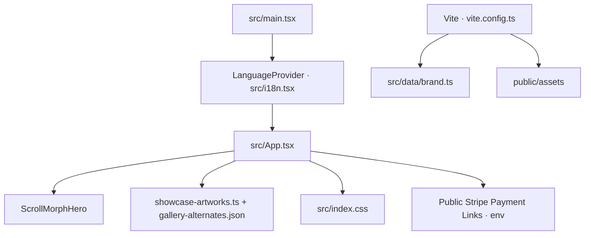

Warning: fs was declared with const; use let for reassignable variables.
# ARTORA Landing

Landing page bilíngue para apresentar a coleção ARTORA de wallpapers. A interface está pronta para publicação estática; o botão de compra só é ativado quando os Payment Links públicos do Stripe são configurados.

## Requisitos

- Node.js 22 (ou versão compatível com Vite 7)
- npm

## Desenvolvimento

```bash
npm ci
npm run dev
```

O Vite inicia o servidor local e recarrega a página ao salvar alterações.

## Build e publicação

```bash
npm run build
npm run preview
```

O build de produção fica em `dist/` e pode ser hospedado em qualquer serviço estático compatível com SPA. Para publicar com checkout, configure as duas variáveis de ambiente na plataforma de hospedagem:

```dotenv
VITE_STRIPE_PAYMENT_LINK_PT_BR=https://buy.stripe.com/...
VITE_STRIPE_PAYMENT_LINK_EN=https://buy.stripe.com/...
```

São URLs públicas de Payment Links, não chaves secretas. O código aceita apenas links HTTPS em `buy.stripe.com`; sem um link válido, a ação de compra permanece desativada. Os meios de pagamento exibidos são uma prévia visual e devem ser conferidos no checkout do Stripe.

## Verificações disponíveis

```bash
npm run build       # TypeScript e build Vite
npm run test:e2e    # Build seguido dos testes Playwright desktop e mobile
```

O Playwright pode precisar baixar os navegadores na primeira execução:

```bash
npx playwright install
```

## Arquitetura



- **Aplicação:** React 19 e TypeScript, iniciados por `src/main.tsx`.
- **Conteúdo e idioma:** `src/i18n.tsx` guarda os textos em português brasileiro e inglês e persiste a escolha no navegador.
- **Apresentação:** `src/App.tsx` compõe as seções da landing; componentes reutilizáveis ficam em `src/components/`.
- **Mídia:** os previews otimizados usados pela página ficam em `public/assets/`. Fontes originais e material de curadoria ficam fora do repositório para evitar publicar rascunhos e imagens-fonte desnecessárias.
- **Build:** Vite injeta metadados de marca definidos em `src/data/brand.ts` no HTML final.
- **Checkout:** links públicos do Stripe são lidos no build pelo Vite. Nenhuma chave secreta deve usar o prefixo `VITE_`.
- **CI:** GitHub Actions instala dependências do lockfile e verifica o build a cada push e pull request.

## Estrutura principal

```text
src/
  components/       Componentes da interface
  data/             Marca e seleção de obras
  App.tsx           Composição da landing
  i18n.tsx          Traduções e preferência de idioma
  index.css         Estilos e responsividade
public/assets/      Imagens otimizadas, fontes e logos
tests/              Cobertura de ponta a ponta com Playwright
scripts/            Ferramentas de geração de assets
```

## Licenças e direitos de mídia

O repositório inclui dependências com as licenças de seus autores. Confira os direitos de uso das obras, marcas e imagens incluídas antes de tornar o repositório público ou redistribuir os arquivos. Os arquivos de origem e as referências de curadoria são ignorados pelo Git.
